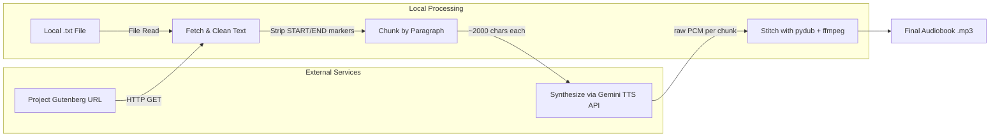

# Gutenberg Storyteller

[](https://www.python.org/)
[](https://ai.google.dev/)
[](LICENSE)

**Gutenberg Storyteller** is a Python tool that automatically converts [Project Gutenberg](https://www.gutenberg.org/) ebooks into narrated audiobooks. It fetches a book's raw text, cleans it, splits it into manageable chunks, synthesizes speech using the **Gemini TTS API** (`gemini-3.1-flash-tts-preview`), and stitches the resulting audio segments into a single MP3 file.

---

## Table of Contents

1. [How It Works](#how-it-works)
2. [Architecture](#architecture)
3. [Prerequisites](#prerequisites)
4. [Installation](#installation)
5. [Configuration](#configuration)
6. [Usage](#usage)
7. [Pipeline Stages](#pipeline-stages)
   - [1. Fetch & Clean Text](#1-fetch--clean-text)
   - [2. Chunk Content into Segments](#2-chunk-content-into-segments)
   - [3. Synthesize Audio via Gemini TTS API](#3-synthesize-audio-via-gemini-tts-api)
   - [4. Stitch Audio Files](#4-stitch-audio-files)
8. [Code Reference](#code-reference)
9. [Production Considerations](#production-considerations)
10. [Troubleshooting](#troubleshooting)
11. [License](#license)

---

## How It Works

The tool implements a **four-stage pipeline**:

| Stage | Description |
|-------|-------------|
| **1. Fetch & Clean** | Downloads the raw `.txt` file from a Project Gutenberg URL **or** reads a local `.txt` file, then strips standardized metadata headers/footers. |
| **2. Chunk** | Splits the cleaned text along paragraph boundaries into segments of ~1,500–2,500 characters to stay within API token limits. |
| **3. Synthesize** | Sends each chunk to the Gemini TTS API (`gemini-3.1-flash-tts-preview`) with a narrator-style prompt and retrieves raw PCM audio. |
| **4. Stitch** | Concatenates all audio segments sequentially into a single output file using `pydub`. |

---

## Architecture



---

## Prerequisites

Before running the tool, ensure you have the following:

### System Dependencies

- **Python 3.10+** — The tool uses modern type hints (`list[str]`) introduced in Python 3.9+.
- **FFmpeg** — Required by `pydub` for audio processing. Install it using one of:

  ```bash
  # macOS (Homebrew)
  brew install ffmpeg

  # Ubuntu / Debian
  sudo apt install ffmpeg

  # Windows (Chocolatey)
  choco install ffmpeg
  ```

  Verify the installation:

  ```bash
  ffmpeg -version
  ```

### API Access

- **Google Gemini API Key** — You need a valid API key from [Google AI Studio](https://aistudio.google.com/apikey). The key must have access to the `gemini-3.1-flash-tts-preview` model with audio generation capabilities.

---

## Installation

1. **Clone the repository:**

   ```bash
   git clone https://github.com/yourusername/gutenberg-storyteller.git
   cd gutenberg-storyteller
   ```

2. **Install [uv](https://docs.astral.sh/uv/) (if not already installed):**

   ```bash
   # Linux / macOS
   curl -LsSf https://astral.sh/uv/install.sh | sh

   # Windows (PowerShell)
   powershell -ExecutionPolicy ByPass -c "irm https://astral.sh/uv/install.ps1 | iex"
   ```

3. **Install Python dependencies:**

   ```bash
   uv sync
   ```

   This creates a `.venv/` directory and installs all dependencies listed in `pyproject.toml`.

---

## Configuration

1. **Copy the example environment file:**

   ```bash
   cp .env.example .env
   ```

2. **Edit `.env` and add your Gemini API key:**

   ```env
   GOOGLE_API_KEY=your_api_key_here
   ```

   The `.env` file is loaded automatically at runtime via `python-dotenv`.

> **Tip:** Never commit your `.env` file to version control. It is listed in `.gitignore` by default.

---

## Usage

### Basic Example

```python
from narrator import build_audiobook

# Generate an audiobook from a Project Gutenberg URL
build_audiobook(
    gutenberg_url="https://www.gutenberg.org/files/11/11-0.txt",
    output_filename="alice_in_wonderland.mp3"
)

# Generate an audiobook from a local text file
build_audiobook(
    book_file="assets/default_book.txt",
    output_filename="cthulhu.mp3"
)

# No source specified — uses assets/default_book.txt
build_audiobook(output_filename="default.mp3")
```

### Customizing Chunk Size

By default, text is chunked at ~2,000 characters. You can adjust this:

```python
build_audiobook(
    gutenberg_url="https://www.gutenberg.org/files/11/11-0.txt",
    output_filename="alice_in_wonderland.mp3",
    max_chars=1500  # Smaller chunks for more granular synthesis
)
```

### Command-Line Usage

You can also run the script directly from the command line. Either `--url` or `--file` may be specified, but not both. If neither is given, the default book at `assets/default_book.txt` is used.

```bash
# From a Project Gutenberg URL
python narrator.py \
    --url "https://www.gutenberg.org/files/11/11-0.txt" \
    --output "alice_in_wonderland.mp3"

# From a local text file
python narrator.py \
    --file "assets/default_book.txt" \
    --output "cthulhu.mp3"

# No source specified — uses assets/default_book.txt
python narrator.py --output "default.mp3"
```

---

## Pipeline Stages

### 1. Fetch & Clean Text

The `fetch_text()` function downloads the raw text file from a Project Gutenberg URL, and `fetch_text_from_file()` reads a local `.txt` file. Both pass the text through `clean_gutenberg_text()` which removes the standardized metadata blocks:

- **Start marker:** `*** START OF THIS PROJECT GUTENBERG EBOOK <title> ***`
- **End marker:** `*** END OF THIS PROJECT GUTENBERG EBOOK <title> ***`

Only the story text between these markers is retained.

```python
def clean_gutenberg_text(text: str) -> str:
    """Strip Project Gutenberg standardized metadata headers/footers."""
    start_match = GUTENBERG_START_RE.search(text)
    end_match = GUTENBERG_END_RE.search(text)

    if start_match and end_match:
        text = text[start_match.end():end_match.start()]

    return text.strip()
```

### 2. Chunk Content into Segments

The `chunk_text()` function splits the cleaned text along paragraph boundaries (`\n\n`) into segments of roughly 1,500–2,500 characters. This approach:

- Avoids exceeding API token limits.
- Prevents speech distortion from overly long inputs.
- Ensures natural pauses at paragraph boundaries.

```python
def chunk_text(text: str, max_chars: int = 2000) -> list[str]:
    """Split text into paragraph-bounded chunks of roughly max_chars."""
    paragraphs = text.split("\n\n")
    chunks: list[str] = []
    current_chunk = ""

    for paragraph in paragraphs:
        cleaned_p = paragraph.replace("\n", " ").strip()
        if not cleaned_p:
            continue

        if len(current_chunk) + len(cleaned_p) < max_chars:
            current_chunk += cleaned_p + "\n\n"
        else:
            chunks.append(current_chunk.strip())
            current_chunk = cleaned_p + "\n\n"

    if current_chunk:
        chunks.append(current_chunk.strip())

    return chunks
```

### 3. Synthesize Audio via Gemini TTS API

The `synthesize_audio()` function sends each text chunk to the Gemini TTS API using the `google-genai` SDK's `interactions.create()` method. A **system prompt** guides the narrator's tone:

> *"Read the following book excerpt aloud clearly, at a measured pace, and with expressive tone like an audiobook narrator."*

The API is configured to return audio by setting `response_format={"type": "audio"}` and specifying a voice via `generation_config`.

```python
def synthesize_audio(chunk: str, client: genai.Client) -> bytes:
    """Synthesize speech for a text chunk using the Gemini TTS API."""
    prompt = NARRATOR_PROMPT + chunk

    interaction = client.interactions.create(
        model="gemini-3.1-flash-tts-preview",
        input=prompt,
        response_format={"type": "audio"},
        generation_config={
            "speech_config": [
                {"voice": "Algenib"}
            ]
        }
    )

    # Extract base64 audio data from the interaction
    audio_data = interaction.output_audio.data

    # Decode base64 audio data
    return base64.b64decode(audio_data)
```

The API returns **raw PCM audio** (16-bit, 24 kHz, mono), which is decoded from base64 and returned as bytes.

### 4. Stitch Audio Files

Each synthesized chunk (raw PCM bytes) is loaded as an `AudioSegment` with the correct sample parameters and appended to a running `final_audio` segment. After all chunks are processed, the combined audio is exported as a single MP3 file.

```python
final_audio = AudioSegment.empty()

for i, chunk in enumerate(chunks):
    logger.info(f"Synthesizing chunk {i + 1}/{len(chunks)}...")

    audio_bytes = synthesize_audio(chunk, client)

    chunk_segment = AudioSegment(
        data=audio_bytes,
        sample_width=2,      # 16-bit
        frame_rate=24000,    # 24 kHz (Gemini TTS output)
        channels=1           # mono
    )
    final_audio += chunk_segment

    time.sleep(1)  # Respect rate limits between calls

final_audio.export(output_filename, format="mp3")
logger.info(f"Audiobook saved successfully as {output_filename}")
```

No temporary files are created — audio is stitched entirely in memory.

---

## Code Reference

The complete implementation is in `narrator.py`:

```python
#!/usr/bin/env python3
"""
narrator.py — Convert a Project Gutenberg ebook into a narrated MP3 audiobook
using the Gemini TTS API (gemini-3.1-flash-tts-preview with response_format={"type": "audio"} output).

Usage:
    python narrator.py --url "https://www.gutenberg.org/files/11/11-0.txt" --output "alice.mp3"
    python narrator.py --file "assets/default_book.txt" --output "cthulhu.mp3"
    python narrator.py --output "default.mp3"  # uses assets/default_book.txt
"""

import argparse
import base64
import binascii
import logging
import os
import re
import time
from typing import Callable, TypeVar

import requests
from dotenv import load_dotenv
from google import genai
from pydub import AudioSegment  # type: ignore[import-untyped]

logger = logging.getLogger(__name__)

# Load environment variables from .env
load_dotenv()

# Validate API key is set
if not os.getenv("GOOGLE_API_KEY"):
    raise RuntimeError(
        "GOOGLE_API_KEY environment variable not set. "
        "Please create a .env file with your API key from https://aistudio.google.com/apikey"
    )

# Narrator system prompt guiding tone and delivery
NARRATOR_PROMPT = (
    "Read the following book excerpt aloud clearly, at a measured pace, "
    "and with expressive tone like an audiobook narrator:\n\n"
)

# Regex patterns for Gutenberg standardized metadata markers
GUTENBERG_START_RE = re.compile(
    r"\*\*\* START OF THIS PROJECT GUTENBERG EBOOK.*?\*\*\*",
    re.IGNORECASE,
)
GUTENBERG_END_RE = re.compile(
    r"\*\*\* END OF THIS PROJECT GUTENBERG EBOOK.*?\*\*\*",
    re.IGNORECASE,
)

T = TypeVar("T")


def retry_with_backoff(
    max_retries: int = 3,
    base_delay: float = 1.0,
    max_delay: float = 30.0,
    exponential_base: float = 2.0,
    exceptions: tuple[type[Exception], ...] = (Exception,),
) -> Callable[[Callable[..., T]], Callable[..., T]]:
    """Decorator that retries a function with exponential backoff."""
    def decorator(func: Callable[..., T]) -> Callable[..., T]:
        def wrapper(*args, **kwargs) -> T:
            delay = base_delay
            last_exception: Exception | None = None

            for attempt in range(max_retries + 1):
                try:
                    return func(*args, **kwargs)
                except exceptions as e:
                    last_exception = e
                    if attempt < max_retries:
                        logger.warning(
                            f"Attempt {attempt + 1}/{max_retries + 1} failed: {e}. "
                            f"Retrying in {delay:.1f}s..."
                        )
                        time.sleep(delay)
                        delay = min(delay * exponential_base, max_delay)
                    else:
                        logger.error(f"All {max_retries + 1} attempts failed. Last error: {e}")

            assert last_exception is not None
            raise last_exception

        return wrapper

    return decorator


def clean_gutenberg_text(text: str) -> str:
    """Strip Project Gutenberg standardized metadata headers/footers."""
    start_match = GUTENBERG_START_RE.search(text)
    end_match = GUTENBERG_END_RE.search(text)

    if start_match and end_match:
        text = text[start_match.end():end_match.start()]

    return text.strip()


def fetch_text(url: str) -> str:
    """Download a Project Gutenberg ebook and strip standardized metadata headers/footers."""
    response = requests.get(url)
    response.raise_for_status()
    return clean_gutenberg_text(response.text)


def fetch_text_from_file(file_path: str) -> str:
    """Read a local text file and strip Project Gutenberg metadata headers/footers."""
    with open(file_path, "r", encoding="utf-8") as f:
        text = f.read()
    return clean_gutenberg_text(text)


def chunk_text(text: str, max_chars: int = 2000) -> list[str]:
    """Split text into paragraph-bounded chunks of roughly max_chars."""
    paragraphs = text.split("\n\n")
    chunks: list[str] = []
    current_chunk = ""

    for paragraph in paragraphs:
        cleaned_p = paragraph.replace("\n", " ").strip()
        if not cleaned_p:
            continue

        # If a single paragraph exceeds max_chars, split it into sentences
        if len(cleaned_p) > max_chars:
            if current_chunk:
                chunks.append(current_chunk.strip())
                current_chunk = ""
            sentences = re.split(r"(?<=[.!?])\s+", cleaned_p)
            sentence_chunk = ""
            for sentence in sentences:
                if len(sentence_chunk) + len(sentence) + 1 <= max_chars:
                    sentence_chunk += sentence + " "
                else:
                    if sentence_chunk:
                        chunks.append(sentence_chunk.strip())
                    sentence_chunk = sentence + " "
            if sentence_chunk:
                chunks.append(sentence_chunk.strip())
            continue

        if len(current_chunk) + len(cleaned_p) <= max_chars:
            current_chunk += cleaned_p + "\n\n"
        else:
            chunks.append(current_chunk.strip())
            current_chunk = cleaned_p + "\n\n"

    if current_chunk:
        chunks.append(current_chunk.strip())

    return chunks


@retry_with_backoff(
    max_retries=3,
    base_delay=1.0,
    max_delay=30.0,
    exceptions=(genai.errors.APIError, genai.errors.ClientError, requests.RequestException),
)
def synthesize_audio(chunk: str, client: genai.Client) -> bytes:
    """Synthesize speech for a text chunk using the Gemini TTS API."""
    prompt = NARRATOR_PROMPT + chunk

    interaction = client.interactions.create(
        model="gemini-3.1-flash-tts-preview",
        input=prompt,
        response_format={"type": "audio"},
        generation_config={
            "speech_config": [
                {"voice": "Algenib"}
            ]
        }
    )

    # Extract audio data from the interaction
    interaction_output_audio = getattr(interaction, "output_audio", None)
    if interaction_output_audio is None or getattr(interaction_output_audio, "data", None) is None:
        logger.warning("No audio data received from Gemini API")
        return b''

    audio_data = interaction_output_audio.data

    # Decode base64 audio data
    try:
        return base64.b64decode(audio_data)
    except (binascii.Error, ValueError) as e:
        logger.error(f"Failed to decode base64 audio data: {e}")
        return b''


def build_audiobook(
    gutenberg_url: str | None = None,
    book_file: str | None = None,
    output_filename: str = "audiobook.mp3",
    max_chars: int = 2000,
) -> None:
    """Convert a Project Gutenberg ebook into a narrated audiobook."""
    client = genai.Client()

    if gutenberg_url:
        logger.info("Downloading book content...")
        book_text = fetch_text(gutenberg_url)
    elif book_file:
        logger.info(f"Reading book from file: {book_file}...")
        book_text = fetch_text_from_file(book_file)
    else:
        default_file = "assets/default_book.txt"
        logger.info(f"No source specified, using default file: {default_file}...")
        book_text = fetch_text_from_file(default_file)

    chunks = chunk_text(book_text, max_chars=max_chars)
    logger.info(f"Split text into {len(chunks)} chunks.")

    final_audio = AudioSegment.empty()

    for i, chunk in enumerate(chunks):
        logger.info(f"Synthesizing chunk {i + 1}/{len(chunks)}...")

        audio_bytes = synthesize_audio(chunk, client)

        if not audio_bytes:
            logger.error(f"Failed to synthesize chunk {i + 1}, skipping...")
            continue

        chunk_segment = AudioSegment(
            data=audio_bytes,
            sample_width=2,
            frame_rate=24000,
            channels=1
        )
        final_audio += chunk_segment

        time.sleep(1)  # Respect rate limits between calls

    final_audio.export(output_filename, format="mp3")
    logger.info(f"Audiobook saved successfully as {output_filename}")


def main() -> None:
    """Parse CLI arguments and run the audiobook pipeline."""
    logging.basicConfig(level=logging.INFO)

    parser = argparse.ArgumentParser(
        description="Convert a Project Gutenberg ebook into a narrated MP3 audiobook."
    )
    source_group = parser.add_mutually_exclusive_group()
    source_group.add_argument(
        "--url",
        help="URL to the raw .txt file on Project Gutenberg.",
    )
    source_group.add_argument(
        "--file",
        help="Path to a local .txt file to narrate.",
    )
    parser.add_argument(
        "--output",
        default="audiobook.mp3",
        help="Output MP3 filename (default: audiobook.mp3).",
    )
    parser.add_argument(
        "--max-chars",
        type=int,
        default=2000,
        help="Maximum characters per text chunk (default: 2000).",
    )

    args = parser.parse_args()

    build_audiobook(
        gutenberg_url=args.url,
        book_file=args.file,
        output_filename=args.output,
        max_chars=args.max_chars,
    )


if __name__ == "__main__":
    main()
```

---

## Production Considerations

### FFmpeg Dependency

`pydub` requires `ffmpeg` to be installed on the host system. Without it, audio loading and export will fail with an error like:

```
FileNotFoundError: [Errno 2] No such file or directory: 'ffmpeg'
```

Ensure `ffmpeg` is installed and available on your system `PATH` (see [Prerequisites](#prerequisites)).

### Voice Customization

You can configure specific voice parameters inside `generation_config` using `speech_config` attributes. This allows targeting specific standard voices available in [Google AI Studio](https://aistudio.google.com/):

```python
generation_config={
    "speech_config": [
        {"voice": "Kore"}  # or any of the 30 available voices
    ]
}
```

Available voices include: **Zephyr** (Bright), **Puck** (Upbeat), **Charon** (Informative), **Kore** (Firm), **Fenrir** (Excitable), **Leda** (Youthful), **Orus** (Firm), **Aoede** (Breezy), **Callirrhoe** (Easy-going), **Autonoe** (Bright), **Enceladus** (Breathy), **Iapetus** (Clear), **Umbriel** (Easy-going), **Algieba** (Smooth), **Despina** (Smooth), **Erinome** (Clear), **Algenib** (Gravelly), **Rasalgethi** (Informative), **Laomedeia** (Upbeat), **Achernar** (Soft), **Alnilam** (Firm), **Schedar** (Even), **Gacrux** (Mature), **Pulcherrima** (Forward), **Achird** (Friendly), **Zubenelgenubi** (Casual), **Vindemiatrix** (Gentle), **Sadachbia** (Lively), **Sadaltager** (Knowledgeable), **Sulafat** (Warm).

### Error Recovery & Caching

For larger books (50+ chunks), a single failure mid-pipeline can waste significant time and API credits. To mitigate this:

- **Cache synthesized chunks** to a local directory (e.g., `cache/`) on disk.
- **Resume from the last successful chunk** on restart by checking which chunk files already exist.
- **Implement retry logic** with exponential backoff for transient API errors.

```python
# Conceptual caching approach
cache_dir = "cache"
os.makedirs(cache_dir, exist_ok=True)

for i, chunk in enumerate(chunks):
    cache_path = os.path.join(cache_dir, f"chunk_{i}.mp3")
    if os.path.exists(cache_path):
        chunk_segment = AudioSegment.from_file(cache_path, format="mp3")
    else:
        # ... synthesize and save to cache_path ...
        pass
    final_audio += chunk_segment
```

### Rate Limiting

The tool includes a `time.sleep(1)` between API calls to respect rate limits. For production use, consider:

- Using a **token bucket** or **leaky bucket** rate limiter.
- Monitoring your [quota usage](https://console.cloud.google.com/iam-admin/quotas) in the Google Cloud Console.
- Implementing **exponential backoff** for `429 Too Many Requests` responses.

---

## Troubleshooting

| Problem | Solution |
|---------|----------|
| `ModuleNotFoundError: No module named 'google.genai'` | Run `uv add google-genai` |
| `FileNotFoundError: ffmpeg` | Install FFmpeg (see [Prerequisites](#prerequisites)) |
| `PermissionError` or `401 Unauthorized` from Gemini API | Verify `GOOGLE_API_KEY` is set correctly in `.env` |
| Audio is silent or distorted | Check that the chunk size is within API limits; reduce `max_chars` |
| `interaction.output_audio.data` is empty | The API may have returned an error; check logs for details |
| Rate limit exceeded (`429`) | Increase the `time.sleep()` interval or implement exponential backoff |

---

## License

This project is licensed under the MIT License — see the [LICENSE](LICENSE) file for details.
