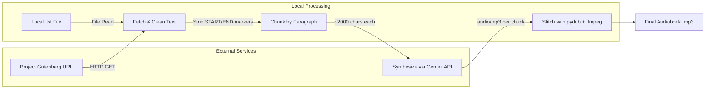

# Gutenberg Storyteller

[](https://www.python.org/)
[](https://ai.google.dev/)
[](LICENSE)

**Gutenberg Storyteller** is a Python tool that automatically converts [Project Gutenberg](https://www.gutenberg.org/) ebooks into narrated audiobooks. It fetches a book's raw text, cleans it, splits it into manageable chunks, synthesizes speech using the **Gemini API**, and stitches the resulting audio segments into a single MP3 file.

---

## Table of Contents

1. [How It Works](#how-it-works)
2. [Architecture](#architecture)
3. [Prerequisites](#prerequisites)
4. [Installation](#installation)
5. [Configuration](#configuration)
6. [Usage](#usage)
7. [Pipeline Stages](#pipeline-stages)
   - [1. Fetch & Clean Text](#1-fetch--clean-text)
   - [2. Chunk Content into Segments](#2-chunk-content-into-segments)
   - [3. Synthesize Audio via Gemini API](#3-synthesize-audio-via-gemini-api)
   - [4. Stitch Audio Files](#4-stitch-audio-files)
8. [Code Reference](#code-reference)
9. [Production Considerations](#production-considerations)
10. [Troubleshooting](#troubleshooting)
11. [License](#license)

---

## How It Works

The tool implements a **four-stage pipeline**:

| Stage | Description |
|-------|-------------|
| **1. Fetch & Clean** | Downloads the raw `.txt` file from a Project Gutenberg URL **or** reads a local `.txt` file, then strips standardized metadata headers/footers. |
| **2. Chunk** | Splits the cleaned text along paragraph boundaries into segments of ~1,500–2,500 characters to stay within API token limits. |
| **3. Synthesize** | Sends each chunk to the Gemini API (`gemini-2.5-flash`) with a narrator-style prompt and retrieves MP3 audio. |
| **4. Stitch** | Concatenates all audio segments sequentially into a single output file using `pydub`. |

---

## Architecture



---

## Prerequisites

Before running the tool, ensure you have the following:

### System Dependencies

- **Python 3.10+** — The tool uses modern type hints (`list[str]`) introduced in Python 3.9+.
- **FFmpeg** — Required by `pydub` for audio processing. Install it using one of:

  ```bash
  # macOS (Homebrew)
  brew install ffmpeg

  # Ubuntu / Debian
  sudo apt install ffmpeg

  # Windows (Chocolatey)
  choco install ffmpeg
  ```

  Verify the installation:

  ```bash
  ffmpeg -version
  ```

### API Access

- **Google Gemini API Key** — You need a valid API key from [Google AI Studio](https://aistudio.google.com/apikey). The key must have access to the `gemini-2.5-flash` model with audio generation capabilities.

---

## Installation

1. **Clone the repository:**

   ```bash
   git clone https://github.com/yourusername/gutenberg-storyteller.git
   cd gutenberg-storyteller
   ```

2. **Install [uv](https://docs.astral.sh/uv/) (if not already installed):**

   ```bash
   # Linux / macOS
   curl -LsSf https://astral.sh/uv/install.sh | sh

   # Windows (PowerShell)
   powershell -ExecutionPolicy ByPass -c "irm https://astral.sh/uv/install.ps1 | iex"
   ```

3. **Install Python dependencies:**

   ```bash
   uv sync
   ```

   This creates a `.venv/` directory and installs all dependencies listed in `pyproject.toml`.

---

## Configuration

1. **Copy the example environment file:**

   ```bash
   cp .env.example .env
   ```

2. **Edit `.env` and add your Gemini API key:**

   ```env
   GEMINI_API_KEY=your_api_key_here
   ```

   The `.env` file is loaded automatically at runtime via `python-dotenv`.

> **Tip:** Never commit your `.env` file to version control. It is listed in `.gitignore` by default.

---

## Usage

### Basic Example

```python
from gutenberg_storyteller import build_audiobook

# Generate an audiobook from a Project Gutenberg URL
build_audiobook(
    gutenberg_url="https://www.gutenberg.org/files/11/11-0.txt",
    output_filename="alice_in_wonderland.mp3"
)

# Generate an audiobook from a local text file
build_audiobook(
    book_file="assets/default_book.txt",
    output_filename="cthulhu.mp3"
)

# No source specified — uses assets/default_book.txt
build_audiobook(output_filename="default.mp3")
```

### Customizing Chunk Size

By default, text is chunked at ~2,000 characters. You can adjust this:

```python
build_audiobook(
    gutenberg_url="https://www.gutenberg.org/files/11/11-0.txt",
    output_filename="alice_in_wonderland.mp3",
    max_chars=1500  # Smaller chunks for more granular synthesis
)
```

### Command-Line Usage

You can also run the script directly from the command line.  Either `--url` or
`--file` may be specified, but not both.  If neither is given, the default book
at `assets/default_book.txt` is used.

```bash
# From a Project Gutenberg URL
python narrator.py \
    --url "https://www.gutenberg.org/files/11/11-0.txt" \
    --output "alice_in_wonderland.mp3"

# From a local text file
python narrator.py \
    --file "assets/default_book.txt" \
    --output "cthulhu.mp3"

# No source specified — uses assets/default_book.txt
python narrator.py --output "default.mp3"
```

---

## Pipeline Stages

### 1. Fetch & Clean Text

The `fetch_and_clean_gutenberg()` function downloads the raw text file from a Project Gutenberg URL **or** reads a local `.txt` file, then removes the standardized metadata blocks:

- **Start marker:** `*** START OF THIS PROJECT GUTENBERG EBOOK <title> ***`
- **End marker:** `*** END OF THIS PROJECT GUTENBERG EBOOK <title> ***`

Only the story text between these markers is retained.

```python
def fetch_and_clean_gutenberg(url: str) -> str:
    response = requests.get(url)
    response.raise_for_status()
    text = response.text

    start_match = re.search(
        r"\*\*\* START OF THIS PROJECT GUTENBERG EBOOK.*?\*\*\*",
        text, re.IGNORECASE
    )
    end_match = re.search(
        r"\*\*\* END OF THIS PROJECT GUTENBERG EBOOK.*?\*\*\*",
        text, re.IGNORECASE
    )

    if start_match and end_match:
        text = text[start_match.end():end_match.start()]

    return text.strip()
```

### 2. Chunk Content into Segments

The `chunk_text_by_paragraph()` function splits the cleaned text along paragraph boundaries (`\n\n`) into segments of roughly 1,500–2,500 characters. This approach:

- Avoids exceeding API token limits.
- Prevents speech distortion from overly long inputs.
- Ensures natural pauses at paragraph boundaries.

```python
def chunk_text_by_paragraph(text: str, max_chars: int = 2000) -> list[str]:
    paragraphs = text.split("\n\n")
    chunks = []
    current_chunk = ""

    for paragraph in paragraphs:
        cleaned_p = paragraph.replace("\n", " ").strip()
        if not cleaned_p:
            continue

        if len(current_chunk) + len(cleaned_p) < max_chars:
            current_chunk += cleaned_p + "\n\n"
        else:
            chunks.append(current_chunk.strip())
            current_chunk = cleaned_p + "\n\n"

    if current_chunk:
        chunks.append(current_chunk.strip())

    return chunks
```

### 3. Synthesize Audio via Gemini API

The `build_audiobook()` function sends each text chunk to the Gemini API using the `google-genai` SDK. A **systemic prompt** guides the narrator's tone:

> *"Read the following book excerpt aloud clearly, at a measured pace, and with expressive tone like an audiobook narrator."*

The API is configured to return audio in MP3 format (`response_mime_type="audio/mp3"`).

```python
response = client.models.generate_content(
    model="gemini-2.5-flash",
    contents=prompt,
    config=types.GenerateContentConfig(
        response_mime_type="audio/mp3"
    )
)
```

Audio bytes are extracted from the response's `inline_data` and saved to temporary files.

### 4. Stitch Audio Files

Each synthesized chunk is loaded as an `AudioSegment` and appended to a running `final_audio` segment. After all chunks are processed, the combined audio is exported as a single MP3 file.

```python
final_audio = AudioSegment.empty()

for i, chunk in enumerate(chunks):
    # ... synthesize chunk ...
    chunk_segment = AudioSegment.from_file(temp_chunk_path, format="mp3")
    final_audio += chunk_segment

final_audio.export(output_filename, format="mp3")
```

Temporary chunk files are cleaned up after each iteration to conserve disk space.

---

## Code Reference

The complete implementation is shown below. Save it as `gutenberg_storyteller.py` (or import the functions into your own project):

```python
import os
import re
import time
import requests
from dotenv import load_dotenv
from google import genai
from google.genai import types
from pydub import AudioSegment

load_dotenv()


def fetch_and_clean_gutenberg(url: str) -> str:
    """Download a Project Gutenberg ebook and strip metadata headers/footers."""
    response = requests.get(url)
    response.raise_for_status()
    text = response.text

    start_match = re.search(
        r"\*\*\* START OF THIS PROJECT GUTENBERG EBOOK.*?\*\*\*",
        text, re.IGNORECASE
    )
    end_match = re.search(
        r"\*\*\* END OF THIS PROJECT GUTENBERG EBOOK.*?\*\*\*",
        text, re.IGNORECASE
    )

    if start_match and end_match:
        text = text[start_match.end():end_match.start()]

    return text.strip()


def chunk_text_by_paragraph(text: str, max_chars: int = 2000) -> list[str]:
    """Split text into paragraph-bounded chunks of roughly max_chars."""
    paragraphs = text.split("\n\n")
    chunks = []
    current_chunk = ""

    for paragraph in paragraphs:
        cleaned_p = paragraph.replace("\n", " ").strip()
        if not cleaned_p:
            continue

        if len(current_chunk) + len(cleaned_p) < max_chars:
            current_chunk += cleaned_p + "\n\n"
        else:
            chunks.append(current_chunk.strip())
            current_chunk = cleaned_p + "\n\n"

    if current_chunk:
        chunks.append(current_chunk.strip())

    return chunks


def build_audiobook(
    gutenberg_url: str | None = None,
    book_file: str | None = None,
    output_filename: str = "audiobook.mp3",
    max_chars: int = 2000
):
    """
    Convert a Project Gutenberg ebook into a narrated audiobook.

    Either *gutenberg_url* or *book_file* may be specified.  If neither is
    given, the default book at ``assets/default_book.txt`` is used.

    Args:
        gutenberg_url: URL to the raw .txt file on Project Gutenberg.
        book_file: Path to a local .txt file to narrate.
        output_filename: Name of the output MP3 file.
        max_chars: Maximum characters per text chunk.
    """
    client = genai.Client()

    if gutenberg_url:
        print("Downloading book content...")
        book_text = fetch_and_clean_gutenberg(gutenberg_url)
    elif book_file:
        print(f"Reading book from file: {book_file}...")
        with open(book_file, "r", encoding="utf-8") as f:
            book_text = f.read()
    else:
        default_file = "assets/default_book.txt"
        print(f"No source specified, using default file: {default_file}...")
        with open(default_file, "r", encoding="utf-8") as f:
            book_text = f.read()

    chunks = chunk_text_by_paragraph(book_text, max_chars=max_chars)
    print(f"Split text into {len(chunks)} chunks.")

    final_audio = AudioSegment.empty()

    for i, chunk in enumerate(chunks):
        print(f"Synthesizing chunk {i + 1}/{len(chunks)}...")

        prompt = (
            "Read the following book excerpt aloud clearly, at a measured pace, "
            f"and with expressive tone like an audiobook narrator:\n\n{chunk}"
        )

        response = client.models.generate_content(
            model="gemini-2.5-flash",
            contents=prompt,
            config=types.GenerateContentConfig(
                response_mime_type="audio/mp3"
            )
        )

        temp_chunk_path = f"temp_{i}.mp3"

        for part in response.candidates[0].content.parts:
            if hasattr(part, "inline_data") and part.inline_data:
                with open(temp_chunk_path, "wb") as f:
                    f.write(part.inline_data.data)

        chunk_segment = AudioSegment.from_file(temp_chunk_path, format="mp3")
        final_audio += chunk_segment

        if os.path.exists(temp_chunk_path):
            os.remove(temp_chunk_path)

        time.sleep(1)  # Respect rate limits between calls

    final_audio.export(output_filename, format="mp3")
    print(f"Audiobook saved successfully as {output_filename}")


# Example Usage:
# build_audiobook(
#     "https://www.gutenberg.org/files/11/11-0.txt",
#     "alice_in_wonderland.mp3"
# )
```

---

## Production Considerations

### FFmpeg Dependency

`pydub` requires `ffmpeg` to be installed on the host system. Without it, audio loading and export will fail with an error like:

```
FileNotFoundError: [Errno 2] No such file or directory: 'ffmpeg'
```

Ensure `ffmpeg` is installed and available on your system `PATH` (see [Prerequisites](#prerequisites)).

### Voice Customization

You can configure specific voice parameters inside `GenerateContentConfig` using `speech_config` attributes. This allows targeting specific standard or custom voice personas available in [Google AI Studio](https://aistudio.google.com/):

```python
config=types.GenerateContentConfig(
    response_mime_type="audio/mp3",
    speech_config=types.SpeechConfig(
        voice=types.VoiceConfig(
            voice_name="en-US-News-L"
        ),
        speaking_rate=1.0,
        pitch=0.0
    )
)
```

### Error Recovery & Caching

For larger books (50+ chapters), a single failure mid-pipeline can waste significant time and API credits. To mitigate this:

- **Cache synthesized chunks** to a local directory (e.g., `cache/`) on disk.
- **Resume from the last successful chunk** on restart by checking which chunk files already exist.
- **Implement retry logic** with exponential backoff for transient API errors.

```python
# Conceptual caching approach
cache_dir = "cache"
os.makedirs(cache_dir, exist_ok=True)

for i, chunk in enumerate(chunks):
    cache_path = os.path.join(cache_dir, f"chunk_{i}.mp3")
    if os.path.exists(cache_path):
        chunk_segment = AudioSegment.from_file(cache_path, format="mp3")
    else:
        # ... synthesize and save to cache_path ...
        pass
    final_audio += chunk_segment
```

### Rate Limiting

The tool includes a `time.sleep(1)` between API calls to respect rate limits. For production use, consider:

- Using a **token bucket** or **leaky bucket** rate limiter.
- Monitoring your [quota usage](https://console.cloud.google.com/iam-admin/quotas) in the Google Cloud Console.
- Implementing **exponential backoff** for `429 Too Many Requests` responses.

---

## Troubleshooting

| Problem | Solution |
|---------|----------|
| `ModuleNotFoundError: No module named 'google.genai'` | Run `uv add google-genai` |
| `FileNotFoundError: ffmpeg` | Install FFmpeg (see [Prerequisites](#prerequisites)) |
| `PermissionError` or `401 Unauthorized` from Gemini API | Verify `GEMINI_API_KEY` is set correctly |
| Audio is silent or distorted | Check that the chunk size is within API limits; reduce `max_chars` |
| `response.candidates[0].content.parts` is empty | The API may have returned an error; inspect `response.candidates[0].finish_reason` |
| Rate limit exceeded (`429`) | Increase the `time.sleep()` interval or implement exponential backoff |

---

## License

This project is licensed under the MIT License — see the [LICENSE](LICENSE) file for details.
