# Plan: `narrator.py` — Minimal Gutenberg-to-Audiobook PoC

## Objective

Create a single-file, executable CLI tool (`narrator.py`) that converts a
Project Gutenberg public-domain book URL into a concatenated MP3 audiobook
using the Gemini TTS API (`gemini-3.1-flash-tts-preview` with `response_format={"type": "audio"}` output).

## Architecture

```mermaid
flowchart LR
    A[CLI: --url --file --output --max-chars] --> B[build_audiobook]
    B --> C[genai.Client]
    C --> D[fetch_text or fetch_text_from_file]
    D -->|regex strip START/END| E[Clean text]
    E --> F[chunk_text]
    F -->|~2000 chars each| G[Chunks]
    G --> H[synthesize_audio]
    H -->|interactions.create| I[Raw PCM bytes per chunk]
    I --> J[Stitch with pydub in-memory]
    J --> K[audiobook.mp3]
```

## Module Layout (single file: `narrator.py`)

| Function | Responsibility |
|---|---|
| `fetch_text(url)` | `requests.get` → strip Gutenberg `*** START ***`/`*** END ***` markers via regex → return clean text |
| `fetch_text_from_file(file_path)` | Read local file → strip Gutenberg markers via regex → return clean text |
| `clean_gutenberg_text(text)` | Strip Gutenberg START/END markers from text |
| `chunk_text(text, max_chars=2000)` | Split on `\n\n` paragraph boundaries; accumulate paragraphs into chunks ≤ `max_chars`; return `list[str]` |
| `synthesize_audio(chunk, client)` | Call `client.interactions.create(model="gemini-3.1-flash-tts-preview", ...)` with `response_format={"type": "audio"}`; extract `output_audio.data` from interaction; return raw PCM `bytes` |
| `build_audiobook(url, book_file, output_filename, max_chars)` | Orchestrate: create `genai.Client()`, fetch → chunk → synthesize each → concatenate via `pydub.AudioSegment` in-memory → export MP3 |
| `main()` | `argparse` CLI: `--url`, `--file`, `--output` (default `audiobook.mp3`), `--max-chars` (default 2000) |

## Design Decisions

1. **`synthesize_audio` returns `bytes`** — keeps the function pure and testable; `build_audiobook` handles in-memory audio stitching.
2. **`argparse`** over `sys.argv` — more robust, self-documenting, matches README usage.
3. **`genai.Client()` created once** in `build_audiobook` and passed to `synthesize_audio` — avoids re-instantiating per chunk.
4. **In-memory audio stitching** — no temp files needed; `AudioSegment` constructed directly from raw PCM bytes.
5. **`time.sleep(1)`** between API calls — respects rate limits (per README guidance).
6. **`.env` loaded** via `python-dotenv` at module import — `GOOGLE_API_KEY` auto-read by `genai.Client()`.
7. **Uses `interactions.create()` API** — the modern Gemini TTS API (not the legacy `models.generate_content()`).
8. **Voice hardcoded to "Algenib"** — gravelly narrator voice suitable for audiobooks.

## Dependencies (already in `pyproject.toml`)

- `google-genai>=2.0.0`
- `requests>=2.31.0`
- `pydub>=0.25.1`
- `python-dotenv>=1.0.0`
- `audioop-lts; python_version >= '3.13'`

## Out of Scope (minimal PoC)

- Caching / resume logic
- Retry with exponential backoff
- Voice customization via CLI (`speech_config`)
- Progress bar / rich output
- Multi-speaker / dialogue support
