# Plan: `narrator.py` — Minimal Gutenberg-to-Audiobook PoC

## Objective

Create a single-file, executable CLI tool (`narrator.py`) that converts a
Project Gutenberg public-domain book URL into a concatenated MP3 audiobook
using the Gemini API (`gemini-2.5-flash` with `audio/mp3` output).

## Architecture

```mermaid
flowchart LR
    A[CLI: --url --output --max-chars] --> B[build_audiobook]
    B --> C[fetch_text]
    C -->|HTTP GET| D[Gutenberg .txt]
    D -->|regex strip START/END| E[Clean text]
    E --> F[chunk_text]
    F -->|~2000 chars each| G[Chunks]
    G --> H[synthesize_audio]
    H -->|Gemini API| I[MP3 bytes per chunk]
    I --> J[Stitch with pydub]
    J --> K[audiobook.mp3]
```

## Module Layout (single file: `narrator.py`)

| Function | Responsibility |
|---|---|
| `fetch_text(url)` | `requests.get` → strip Gutenberg `*** START ***`/`*** END ***` markers via regex → return clean text |
| `chunk_text(text, max_chars=2000)` | Split on `\n\n` paragraph boundaries; accumulate paragraphs into chunks ≤ `max_chars`; return `list[str]` |
| `synthesize_audio(chunk, client)` | Call `client.models.generate_content(model="gemini-2.5-flash", ...)` with `response_mime_type="audio/mp3"`; extract `inline_data.data` from response parts; return `bytes` |
| `build_audiobook(url, output_filename, max_chars)` | Orchestrate: create `genai.Client()`, fetch → chunk → synthesize each → concatenate via `pydub.AudioSegment` → export MP3 → clean temp files |
| `main()` | `argparse` CLI: `--url` (required), `--output` (default `audiobook.mp3`), `--max-chars` (default 2000) |

## Design Decisions

1. **`synthesize_audio` returns `bytes`** — keeps the function pure and testable;
   `build_audiobook` handles temp-file I/O and cleanup.
2. **`argparse`** over `sys.argv` — more robust, self-documenting, matches README usage.
3. **`genai.Client()` created once** in `build_audiobook` and passed to `synthesize_audio`
   — avoids re-instantiating per chunk.
4. **Temp files** written to a `tempfile.TemporaryDirectory()` context manager —
   guarantees cleanup even on error.
5. **`time.sleep(1)`** between API calls — respects rate limits (per README guidance).
6. **`.env` loaded** via `python-dotenv` at module import — `GEMINI_API_KEY` auto-read
   by `genai.Client()`.

## Dependencies (already in `pyproject.toml`)

- `google-genai>=2.0.0`
- `requests>=2.31.0`
- `pydub>=0.25.1`
- `python-dotenv>=1.0.0`

## Out of Scope (minimal PoC)

- Caching / resume logic
- Retry with exponential backoff
- Voice customization (`speech_config`)
- Progress bar / rich output
