# Code Review: Gutenberg Storyteller

## Overview

A comprehensive review of the `gutenberg-storyteller` project — a Python CLI tool that converts Project Gutenberg ebooks into narrated MP3 audiobooks using the Gemini TTS API.

---

## 1. Critical Issues

### 1.1 README is Severely Out of Date

The `README.md` documents a **completely different implementation** than what exists in `narrator.py`. The README shows:

- `client.models.generate_content()` API (old Gemini API)
- `gemini-2.5-flash` model
- `response_modalities=["AUDIO"]` config
- `part.inline_data.data` extraction from `response.candidates[0].content.parts`
- Temp-file-based approach (`temp_{i}.mp3`)
- `print()` statements instead of `logging`
- Function names: `fetch_and_clean_gutenberg()`, `chunk_text_by_paragraph()`

The actual `narrator.py` uses:

- `client.interactions.create()` API (new Gemini TTS API)
- `gemini-3.1-flash-tts-preview` model
- `response_format={"type": "audio"}` config
- `interaction.output_audio.data` extraction
- In-memory `AudioSegment` construction (no temp files)
- `logging` module
- Function names: `fetch_text()`, `fetch_text_from_file()`, `chunk_text()`

**Impact:** Anyone following the README will write code that doesn't work. The README's "Code Reference" section (lines 315-450) is a standalone implementation that doesn't match the actual `narrator.py`.

### 1.2 `.env.example` Uses Wrong Key Name

`.env.example` defines `GEMINI_API_KEY=your_api_key_here` but the actual `.env` file uses `GOOGLE_API_KEY="..."`. The `google-genai` SDK reads `GOOGLE_API_KEY` by default. The `.env.example` should be updated to match.

### 1.3 Docstring Model Name Mismatch

`narrator.py` line 4 says `gemini-3.8-flash` but the actual model used (line 146) is `gemini-3.1-flash-tts-preview`. The Google docs confirm `gemini-3.1-flash-tts-preview` is the correct TTS model.

### 1.4 `launch.json` Passes a Markdown File as Book Input

`.vscode/launch.json` (line 21) passes `assets/default_book_google.md` as the `--file` argument. This file is a **markdown document with director's notes, scene descriptions, and audio tags** — not a clean book text. The `fetch_text_from_file()` function will call `clean_gutenberg_text()` on it, which is a no-op (no START/END markers), so the entire markdown content (including `## Audio Profile`, `### DIRECTOR'S NOTES`, etc.) would be sent to the Gemini TTS API.

This may be **intentional** — the file is designed as a prompt for Gemini's controllable TTS, where the director's notes guide the narration style. However, it's confusing because:
- The file extension is `.md`, not `.txt`
- The `clean_gutenberg_text()` function is applied unnecessarily
- The launch config doesn't match the documented usage patterns

---

## 2. High-Priority Issues

### 2.1 Overly Complex Response Handling in `synthesize_audio()`

The `synthesize_audio()` function (lines 131-197) has complex logic to handle both "Stream" and "Interaction" response types, checking `hasattr(interaction, "__iter__")` and iterating through events. However, the Google TTS docs show a simple pattern:

```python
interaction = client.interactions.create(...)
wave_file('out.wav', base64.b64decode(interaction.output_audio.data))
```

The API returns a synchronous `Interaction` object with an `output_audio` property. The stream handling code is likely unnecessary and may introduce bugs. The `is_stream` check using `hasattr(interaction, "__iter__")` is fragile — many objects are iterable.

### 2.2 No Retry Logic for API Failures

The Google docs explicitly state:

> "The model occasionally returns text tokens instead of audio tokens, causing the server to fail the request with a `500` error. Because this occurs randomly in a very small percentage of requests, you should implement automated retry logic in your application to handle these."

The current code has no retry logic. A single transient failure will cause the entire audiobook generation to fail, wasting all prior progress.

### 2.3 No API Key Validation

The code creates `genai.Client()` without checking if the API key is set. If `GOOGLE_API_KEY` is missing, the error will be cryptic. A clear error message should be raised early.

### 2.4 Missing LICENSE File

The README references a `LICENSE` file (line 531) and the badge links to it, but no `LICENSE` file exists in the project.

### 2.5 No Handling of Empty Audio Bytes in `build_audiobook`

If `synthesize_audio()` returns `b''` (empty bytes on failure), the `AudioSegment(data=b'', ...)` constructor on line 257 will raise an error. The code should check for empty bytes and either skip the chunk or raise a clear error.

---

## 3. Medium-Priority Issues

### 3.1 Dead Commented-Out Code

Lines 200-212 contain commented-out code from the old `models.generate_content()` approach. This should be removed to keep the codebase clean.

### 3.2 Incorrect Audio Format Documentation

The code constructs `AudioSegment` from raw PCM data (lines 257-269) with `sample_width=2, frame_rate=24000, channels=1`. This is correct per the Google docs (the API returns 16-bit, 24kHz, mono PCM). However:

- The docstring says "Raw MP3 audio bytes" (line 140) — it's actually **raw PCM**, not MP3
- The README says "audio/mp3 per chunk" (line 52) — incorrect
- The `synthesize_audio` docstring should say "raw PCM audio bytes"

### 3.3 No Caching / Resume Logic

The plan (line 42-43) mentions `tempfile.TemporaryDirectory()` for temp files, but the code doesn't use temp files at all. More importantly, there's no caching or resume capability. For a full book (potentially 50+ chunks), a single failure mid-pipeline means starting over. The README's "Production Considerations" section (lines 483-504) discusses caching but it's not implemented.

### 3.4 `time.sleep(1)` is a Naive Rate Limiter

Line 272 uses a fixed 1-second sleep between API calls. This doesn't account for actual rate limits or API response times. A token-bucket or adaptive rate limiter would be more robust.

### 3.5 `chunk_text` Edge Case

The `chunk_text` function (line 117) uses `<` instead of `<=`:
```python
if len(current_chunk) + len(cleaned_p) < max_chars:
```
This means a chunk could be up to `max_chars + len(cleaned_p) - 1` characters, potentially exceeding the limit if a single paragraph is very long. A single paragraph longer than `max_chars` would create a chunk larger than `max_chars`.

### 3.6 `main()` Docstring Placement

Line 281 has a docstring inside the `main()` function body, after `logging.basicConfig()`. Docstrings should be the first statement in a function. This means `main.__doc__` will be `None`.

### 3.7 Stray Comment Block

Lines 127-129 have a block of URLs with no context between `chunk_text` and `synthesize_audio`:
```python
# https://github.com/jiaaro/pydub
# https://github.com/jiaaro/pydub/issues/725
# https://docs.python.org/3/library/wave.html
```
These appear to be leftover reference links with no clear purpose.

### 3.8 Stale TODO Comment

Line 252 has `# TODO: Use logging and get the timestamp as a bonus` but logging is already being used on the next line. This TODO is outdated.

### 3.9 `WIP.md` is Unfinished

The `WIP.md` file contains audiobook industry terminology and pipeline documentation, but it's incomplete (the "Terminology" section at line 1 is empty, and the file appears to be a work-in-progress reference document). It's not clear how this relates to the actual implementation.

---

## 4. Low-Priority / Cosmetic Issues

### 4.1 `pyproject.toml` Author Placeholder

Line 9 has `{ name = "Your Name", email = "you@example.com" }` — a placeholder that should be filled in.

### 4.2 `uv.lock` Not Reviewed

The `uv.lock` file exists but wasn't reviewed for dependency version conflicts.

### 4.3 `elevenlabs/` Documentation

The `elevenlabs/` directory contains API documentation but there's no code using ElevenLabs. This appears to be reference material for potential future TTS provider support.

---

## 5. Architecture Assessment

### Current Architecture (Actual Code)

```mermaid
flowchart LR
    A[CLI: --url --file --output --max-chars] --> B[build_audiobook]
    B --> C[genai.Client]
    C --> D[fetch_text or fetch_text_from_file]
    D -->|regex strip START/END| E[Clean text]
    E --> F[chunk_text]
    F -->|~2000 chars each| G[Chunks]
    G --> H[synthesize_audio]
    H -->|interactions.create| I[Raw PCM bytes per chunk]
    I --> J[Stitch with pydub in-memory]
    J --> K[audiobook.mp3]
```



### Key Architectural Observations

1. **Single-file design** is appropriate for a PoC — keeps things simple and portable.
2. **In-memory audio stitching** (no temp files) is actually better than the plan's temp-file approach — avoids disk I/O and cleanup issues.
3. **The `interactions.create()` API** is the correct modern Gemini TTS API, matching the Google docs.
4. **The `default_book_google.md` file** is a sophisticated prompt with director's notes, scene descriptions, and audio tags — this leverages Gemini TTS's "controllable" speech generation feature well.
5. **The project is split between two approaches**: the actual code uses the new `interactions` API, while the README/plan document the old `models.generate_content()` API.

---

## 6. Recommendations

### Immediate (Must Fix)

1. **Update README.md** to match the actual `narrator.py` implementation — document `client.interactions.create()`, `gemini-3.1-flash-tts-preview`, `response_format={"type": "audio"}`, `interaction.output_audio.data`, in-memory `AudioSegment`, and `logging`.
2. **Fix `.env.example`** to use `GOOGLE_API_KEY` instead of `GEMINI_API_KEY`.
3. **Fix the docstring** on line 4 to say `gemini-3.1-flash-tts-preview` instead of `gemini-3.8-flash`.
4. **Fix the `synthesize_audio` docstring** to say "raw PCM audio bytes" instead of "Raw MP3 audio bytes".
5. **Add a LICENSE file** (MIT, as referenced in README).
6. **Remove commented-out dead code** (lines 200-212).
7. **Fix the `main()` docstring** placement (move to first line of function).

### High Priority

8. **Simplify `synthesize_audio()`** — remove the complex stream handling and use the simple `interaction.output_audio.data` pattern from the Google docs.
9. **Add retry logic** with exponential backoff for API failures (especially the documented 500 errors).
10. **Add API key validation** — check for `GOOGLE_API_KEY` before creating the client.
11. **Add empty audio bytes check** in `build_audiobook` — handle the case where `synthesize_audio` returns `b''`.
12. **Clarify the `launch.json` configuration** — either document that `default_book_google.md` is a prompt file (not a book), or change the config to use `default_book.txt`.

### Medium Priority

13. **Add caching/resume logic** — cache synthesized chunks to disk and resume from the last successful chunk on restart.
14. **Fix `chunk_text` edge case** — handle paragraphs longer than `max_chars` by splitting them.
15. **Replace `time.sleep(1)`** with a proper rate limiter.
16. **Remove stray comment block** (lines 127-129) and stale TODO (line 252).
17. **Fill in the `pyproject.toml` author** placeholder.
18. **Clean up or document `WIP.md`** — either complete it or remove it.

### Low Priority

19. **Add tests** — the `dev` dependencies include `pytest` but there are no test files.
20. **Add a `requirements.txt`** or ensure `uv.lock` is committed for reproducible installs.
21. **Consider adding a `--voice` CLI argument** to allow voice selection (the code hardcodes "Algenib").
